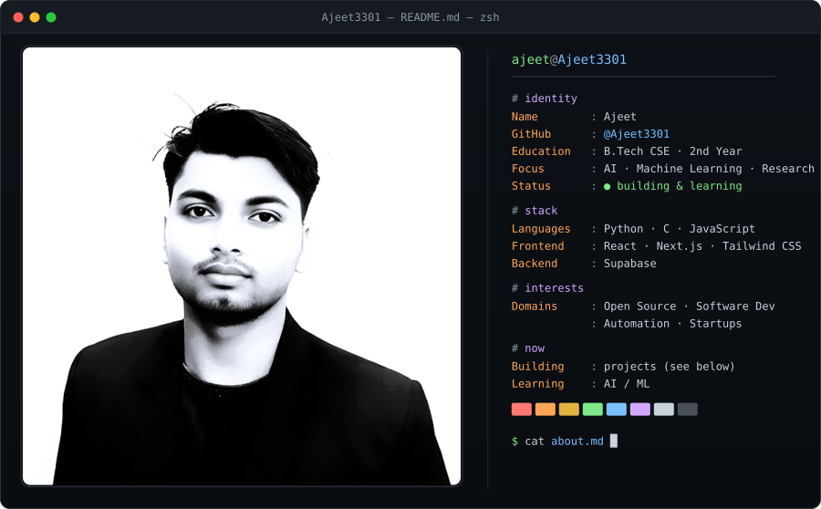

<div align="center">

<!-- ========================================== -->
<!-- 1. TERMINAL HEADER & ASCII GLOBE HERO     -->
<!-- ========================================== -->

<a href="https://github.com/Ajeet3301">
  
</a>

<br/>

<p align="center">
  <a href="#-identity--system-specs">
    
  </a>
  <a href="#-academic--research-focus">
    
  </a>
  <a href="#-social--communication-channels">
    
  </a>
  <a href="https://github.com/Ajeet3301?tab=repositories">
    
  </a>
</p>

</div>

---

### `❯` `whoami --detailed`

```ansi
┌──(ajeet@Ajeet3301)-[~/identity]
└─$ cat profile.json
```

```json
{
  "developer": "Ajeet",
  "handle": "@Ajeet3301",
  "academic": {
    "degree": "B.Tech in Computer Science & Engineering",
    "year": "2nd Year",
    "core": ["Data Structures", "Algorithms", "Computer Systems", "Mathematics for ML"]
  },
  "specialization": {
    "primary": "Artificial Intelligence & Machine Learning",
    "subfields": ["Deep Learning", "Neural Network Architectures", "Empirical Research"]
  },
  "interests": [
    "Open Source Ecosystem",
    "High-Performance Software",
    "Automation & Tooling",
    "Tech Startups"
  ],
  "mission": "Engineering intelligent algorithms and scalable software systems from first principles."
}
```

---

### `❯` `neofetch --system`

<table>
<tr>
<td width="50%" valign="top">

```yaml
# SYSTEM ENVIRONMENT
OS          : Arch Linux / macOS / POSIX
Shell       : zsh 5.9 (x86_64-pc-linux-gnu)
Editor      : Neovim / VS Code (Tokyo Night)
Terminal    : Alacritty / Ghostty
Uptime      : 2nd Year B.Tech CSE
Workstation : Research & Engineering Rig
Status      : Active ● Compiling ideas
```

</td>
<td width="50%" valign="top">

```yaml
# CURRENT FOCUS & OBJECTIVES
[01] Deepening mathematical foundations for Deep Learning.
[02] Training & fine-tuning open-weights models.
[03] Building full-stack web applications with Next.js & Supabase.
[04] Writing clean, idiomatic C and Python systems code.
[05] Contributing to developer-first open source tooling.
```

</td>
</tr>
</table>

---

### `❯` `stack --list --verbose`

<div align="center">

| Domain | Core Technologies & Frameworks |
| :--- | :--- |
| **Core Languages** |    |
| **Frontend Engineering** |      |
| **Backend & Cloud Data** |    |
| **AI, ML & Scientific** |     |
| **Tools & Infrastructure** |      |

</div>

---

### `❯` `gh stats --user Ajeet3301 --theme custom-dark`

<div align="center">

<table border="0">
  <tr>
    <td valign="top" width="50%">
      
    </td>
    <td valign="top" width="50%">
      
    </td>
  </tr>
</table>

<p align="center">
  
</p>

</div>

---

### `❯` `git log --graph --activity-tracker`

<div align="center">
  
</div>

---

### `❯` `ls -la ~/featured-projects`

```ansi
total 3 repositories
drwxr-xr-x  4 ajeet dev 4096 Nov 02 20:50 ./ai-research-lab
drwxr-xr-x  6 ajeet dev 4096 Nov 02 20:50 ./modern-saas-platform
drwxr-xr-x  3 ajeet dev 4096 Nov 02 20:50 ./dev-automation-cli
```

<table>
<tr>
<td width="33%" valign="top">

#### `01` `ai-research-lab`
> *Machine Learning Experiments & Deep Learning Notebooks.*

- **Scope:** Exploratory research on computer vision & NLP models, loss optimizations, and training benchmarks.
- **Stack:** `Python` `PyTorch` `NumPy` `Jupyter`
- **Branch:** `main` ● Active

```bash
$ git clone https://github.com/Ajeet3301/ai-research-lab.git
```
[➔ Explore Repository](https://github.com/Ajeet3301?tab=repositories)

</td>
<td width="33%" valign="top">

#### `02` `modern-web-app`
> *Full-Stack Cloud Application with Reactive Interface.*

- **Scope:** Modern responsive web application utilizing Next.js app directory, Tailwind styling, and Supabase auth/database.
- **Stack:** `Next.js` `React` `Tailwind CSS` `Supabase`
- **Branch:** `main` ● Deployed

```bash
$ git clone https://github.com/Ajeet3301/modern-web-app.git
```
[➔ Explore Repository](https://github.com/Ajeet3301?tab=repositories)

</td>
<td width="33%" valign="top">

#### `03` `dev-automation-suite`
> *Automated Workflows & Command-Line Utilities.*

- **Scope:** Modular scripts and CLI automation designed to streamline local developer environments and data pipelines.
- **Stack:** `Python` `C` `Bash` `GitHub Actions`
- **Branch:** `main` ● Maintained

```bash
$ git clone https://github.com/Ajeet3301/dev-automation-suite.git
```
[➔ Explore Repository](https://github.com/Ajeet3301?tab=repositories)

</td>
</tr>
</table>

> *Note: Visit [github.com/Ajeet3301](https://github.com/Ajeet3301?tab=repositories) to inspect public repositories, forks, and experimental gists.*

---

### `❯` `ping -c 4 network.ajeet.dev`

<div align="center">

```ansi
PING network.ajeet.dev (127.0.0.1) 56(84) bytes of data.
64 bytes from localhost: icmp_seq=1 ttl=64 time=0.032 ms
64 bytes from localhost: icmp_seq=2 ttl=64 time=0.028 ms
--- network.ajeet.dev ping statistics: 0% packet loss ---
```

<br/>

<a href="https://github.com/Ajeet3301">
  
</a>
<a href="https://linkedin.com/in/YOUR_LINKEDIN_HANDLE">
  
</a>
<a href="https://x.com/YOUR_TWITTER_HANDLE">
  
</a>
<a href="mailto:your_email@example.com">
  
</a>
<a href="https://yourportfolio.dev">
  
</a>

</div>

<br/>

---

<div align="center">

```text
+-----------------------------------------------------------------------+
|  [SYS_STATUS]: ALL NODES NOMINAL  ::  KERNEL: 6.11.x-zen  ::  TTY: 0  |
|  "Stay hungry, stay foolish, and optimize your loss functions."       |
+-----------------------------------------------------------------------+
```

<sub>Generated with precision for <strong>Ajeet3301</strong> • Configured for Dark Mode</sub>

</div>
